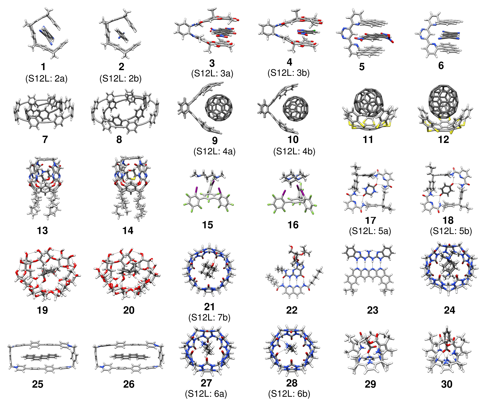

# S30L Benchmark Set

Host-guest association energy benchmark set of 30 noncovalent complexes (neutral and charged, up to 200 atoms), evaluated against empirical ("experimental") gas-phase association energies.

## Dataset Information
- **Systems**: 30 association energies, `ΔE = E(AB) - E(A) - E(B)` (A = host, B = guest, AB = complex), i.e. 90 single-point systems.
- **Reference Level**: Empirical gas-phase association energies ΔE_emp in kcal/mol, obtained by back-correcting the experimental free energies of association with computed thermostatistical (HF-3c, modified RRHO) and solvation (COSMO-RS) contributions. These are the S30L (without counterions) values; the S30L-CI variants (complexes 23-26 and 29-30 with counterions) are not part of this set.
- **Charges**: Complexes 1-22 are neutral. `.CHRG` files are present for the charged complexes, in the folder of the charged species and of the complex: 23 (+1, guest), 24 (+2, guest), 25 and 26 (+4, host), 27 and 28 (+1, guest), 29 and 30 (-1, guest).
- **Source**: Sure, R.; Grimme, S., *J. Chem. Theory Comput.*, **2015**, 11, 3785–3801 ([DOI: 10.1021/acs.jctc.5b00296](https://doi.org/10.1021/acs.jctc.5b00296)). The `paper/` folder contains the article, its correction and the supporting information (including the original coordinates).
- **Geometries**: Located inside the `S30L/` folder as `S30L/<n>/{A,B,AB}/`. Each system has `mol.xyz` (Angstrom) and `geom.xyz` (identical copy) plus the original Turbomole `coord` file (atomic units). In the complex, host atoms come first and guest atoms second, in the same order as in `A` and `B`. The complexes are numbered according to `s30l.png`.
- **Evaluation**: The `.res` file contains the reference energies in kcal/mol. Use the [`tmer2++`](https://github.com/grimme-lab/tmer2) script to evaluate calculated energies against these references.

## Utils

The `.list` file is created via `find S30L -mindepth 2 -maxdepth 2 -type d | sort -V > .list` (one line per system, `S30L/<n>/{A,B,AB}`).
